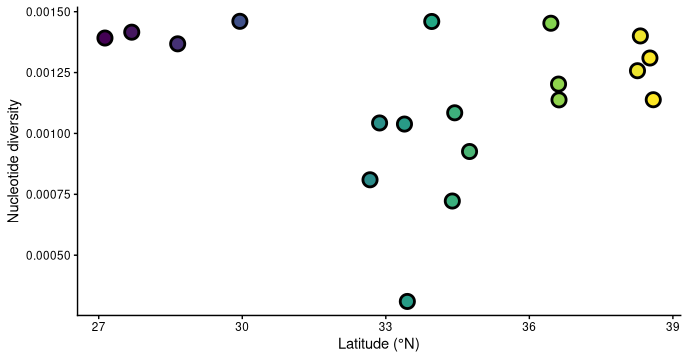
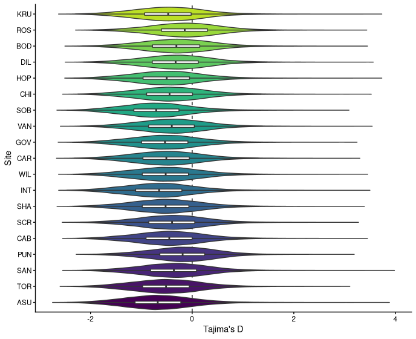
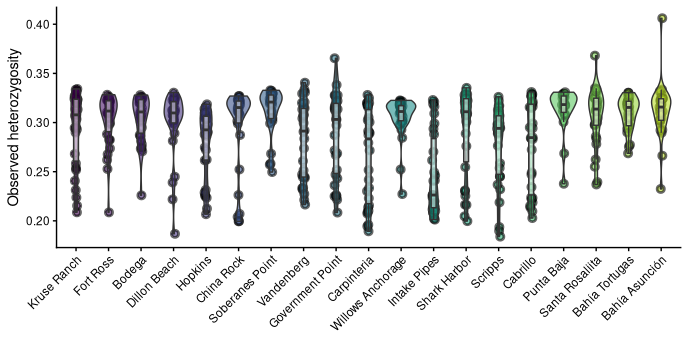
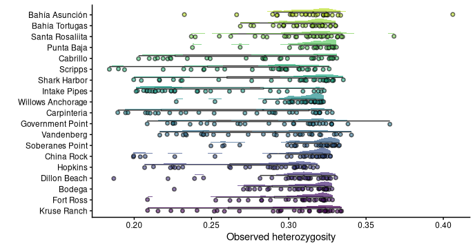

# Population Genomics Notebook

**Course:** Intro to Ecological Genomics **Name:** Ella Rewinkel

\<\div\>

# 10.13.2026 Working with Population Genomics: Class 1

**Overview**

Today, we began working with VCF (Variant Call Format) files, which have
two parts:

1.  Header: lines starting with \## that record how the file was made
    and define every field used in it

2.  Body: one line per variant

We ended with 3.5: Reading a variant record, and have not yet begun 3.6
in the tutorial for Day 1.

# 10.15.2026 Working with Population Genomics: Class 2

Today, we updated our .gitignore file to push our work from Class 1. We
looked at the NIH (Natiional Library of Medicine), and in doing so,
learned that we can find SRA Data for a species if we search for it.
This is where we got the data for our VCFs. We learned that the pathway
from last class was incorrect, so we updated it in the 10.13.2026
script.

We had to delete the new mydata files from Tuesday (which I did in the
Vacc website under Files and then Home Directory) and add the corrected
ones with this:

cp /gpfs1/cl/biol3990/PopulationGenomics/VCF/*.vcf*
/gpfs1/home/e/r/erewinke/projects/eco_genomics_2026/population_genomics/mydata

In Terminal:

nano

#!/bin/bash #SBATCH --nodes=1 #SBATCH --cpus-per-task=1 #SBATCH --mem=5G
#SBATCH --time=1:00:00 #SBATCH --output=./logs/%x.%j.out #SBATCH
--error=./logs/%x.%j.err #SBATCH --mail-type=END #SBATCH
--[mail-user=erewinke\@uvm.edu](mailto:mail-user=erewinke@uvm.edu){.email}

cd
\~/gpfs1/home/e/r/erewinke/projects/eco_genomics_2026/population_genomics/mydata

module load gcc module load vcftools

vcftools --gzvcf Lottia_gigantea_pl_flt3.renamed.vcf.gz --missing-indv
--out missing_data vcftools --gzvcf
Lottia_gigantea_pl_flt3_renamed.vcf.gz --depth --out depth_data

(now do CTRL S to submit the job and title/ID it as "vcf_stats.sh)

Just so you know (we didn't do this): squeue -u \$USER \# check your
jobs (PD = pending, R = running) scancel <jobid> \# cancel a job if you
need to

# 10.20.2026 Day 3 PopGen

## Overview

Today, we created PCA plots to differentiate populations by latitude,
and analyzed data from a previously-run ADMIXTURE. The plots are saved
in population_structure folder.

## Notes on Batch Jobs

## Extra

DATA_DIR=users/e/r/erewinke/projects/eco_genomics_2026/population_genomics/mydata
\^ this does not save in the vacc, so must put in every time

We used "module load plink" and then "module list" to get to the module
version we're using, which is plink/1.9b7.7 PLINK v1.9.0-b.7.7 64-bit
(22 Oct 2024)

Notes on Admixture: \* ADMIXTURE takes a model-based approach to
population structure. It assumes our individuals descend from K
ancestral populations, each with its own allele frequencies, and
estimates the proportion of each individual’s genome that comes from
each of them (its ancestry proportions). It uses the same model as the
program STRUCTURE but is much faster. \* We don’t know the true K, so we
run ADMIXTURE for a range of values and use cross-validation to see
which ones fit the data best.

# What I put in terminal to run the batch for today:

nano

#!/bin/bash #SBATCH --job-name=admixture #SBATCH --partition=general
#SBATCH --nodes=1 #SBATCH --cpus-per-task=8 #SBATCH --mem=16G #SBATCH
--time=24:00:00 #SBATCH --output=./logs/%x.%j.out #SBATCH
--error=./logs/%x.%j.err #SBATCH --mail-type=ALL #SBATCH
--[mail-user=erewinke\@uvm.edu](mailto:mail-user=erewinke@uvm.edu){.email}

cd
/gpfs1/home/e/r/erewinke/projects/eco_genomics_2026/population_genomics/myscripts

OUTDIR=/gpfs1/home/e/r/erewinke/projects/eco_genomics_2026/population_genomics/myresults

echo \$OUTDIR

VCF=Lottia_gigantea_pl_flt3.renamed.vcf.gz

echo \$VCF

module load plink

DATA_DIR=/gpfs1/home/e/r/erewinke/projects/eco_genomics_2026/population_genomics/myresults

VCF=\$DATA_DIR/Lottia_gigantea_pl_flt3.renamed.vcf.gz

cd \$DATA_DIR

plink --vcf \$VCF --double-id --allow-extra-chr\
--set-missing-var --indep-pairwise 50 10 0.2\
--out \$OUTDIR/Lg_LD_0.2_alldata

plink --vcf \$VCF --double-id --allow-extra-chr\
--set-missing-var --extract \$OUTDIR/Lg_LD_0.2_alldata.prune.in\
--make-bed --pca --out \$OUTDIR/Lg_LD_0.2_alldata

echo "my script is done!"

## then put "sbatch mypcajob.sh" in Terminal after exiting nano to send

\<\div\>

# 10.22.26 Genetic Diversity

**Overview** We copied pi files over and created ggplots to represent
genetic diversity.

**Notes**

-   For genetic diversity, we can look:

    -   within individual

    -   within population

    -   within species

-   Metrics of genetic diversity

    -   Heterozygosity

    -   Private allele -\> allele richness

    -   F_ST -\> fixation index (metric for looking at pop
        differentiation)

    -   Ne -\> Genetic (pop size); Nc -\> Consensus (pop size)

    -   Nucleotide diversity (depicted as pi)

    -   Inbreeding coefficient -\> F_is

    -   \% polymorphism

**Module Version Used**

vcftools/0.1.16

**Put in Terminal**

cd /gpfs1/cl/biol3990/PopulationGenomics

ll

cd GeneticDiversity/

ls

cp -r \*
/gpfs1/home/e/r/erewinke/projects/eco_genomics_2026/population_genomics/mydata

cd ..

cd GeneticDiversity/

module load vcftools

module list

ll

DATA_DIR=/gpfs1/home/e/r/erewinke/projects/eco_genomics_2026/population_genomics/mydata/

echo \$DATA_DIR

VCF=\$DATA_DIR/Lottia_gigantea_pl_flt3_sub0.01.vcf.gz

head sample_metadata.csv

cd
/gpfs1/home/e/r/erewinke/projects/eco_genomics_2026/population_genomics/mydata/

tail -n +2 sample_metadata.csv \| cut -d ',' -f 1,2 \| tr ',' '\\t' \>
popmap.txt

head popmap.txt

# 10.27.2026 Genetic Diversity cont'd

**Overview**

Today, we generated plots to analyze genetic diversity. We also
calculated genome-wide and windowed pairwise F_ST using vcftools and
plotted an F_ST genome scan in R.

**Working Directory:**

/gpfs1/home/e/r/erewinke/projects/eco_genomics_2026/population_genomics/mydata

**Heterozygosity**

-   Observed heterozygosity (HO) is the proportion of sites at which an
    individual is heterozygous.

-   Expected heterozygosity (HE) is the proportion we would expect if
    the population mated at random (Hardy–Weinberg equilibrium): 2pq at
    each site, where p and q are the allele frequencies.

-   The inbreeding coefficient compares the two: F = 1 − HO / HE. F = 0
    means an individual is as heterozygous as expected, F \> 0 means
    less heterozygous, and F \< 0 means more.

-   Possible causes for positive F (too few heterozygotes): Inbreeding
    (mating between relatives); genotyping errors, especially at low
    coverage, where heterozygotes are miscalled as homozygotes

-   Possible causes for negative F (too many heterozygotes): LESS inbred
    (mating between divergent populations); mapping errors; where reads
    from duplicated regions (paralogs) pile up on one locus and look
    like heterozygotes in everyone

**Plots**

\^ This is not saved in R.

![Scan plot for pi. Tajima's D is calculated by VCF (read in files,
windows filtered out with less than 5 SNPs, and pop data readded).
Positive selection (new beneficial allele appears and shifts
distribution/frequency over, sweeping across the population) is
signified by negative Tajima's D (there is an excess of rare alleles
sweeping through population and shifting distribution).
Negative/stabilizing selection is signified by positive Tajima's D: bell
curve gets narrower as alleles/traits are
purged.](images/clipboard-3599083371.png)

