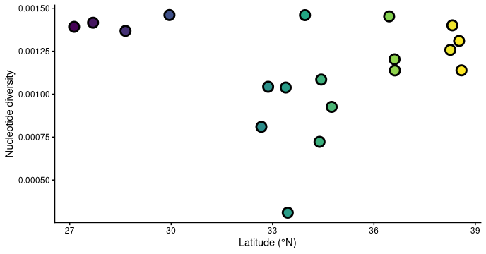
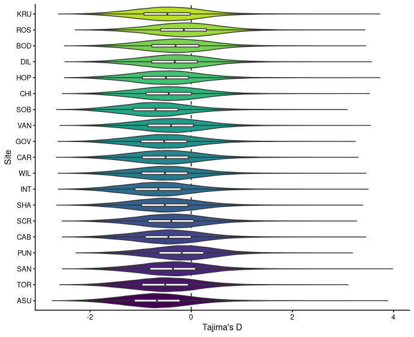
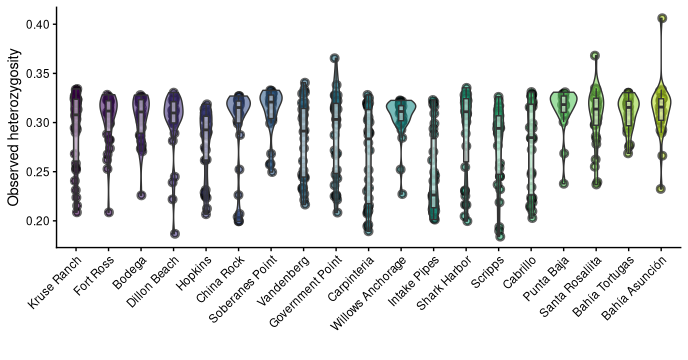
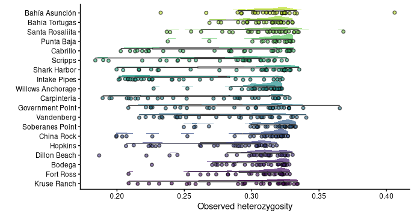
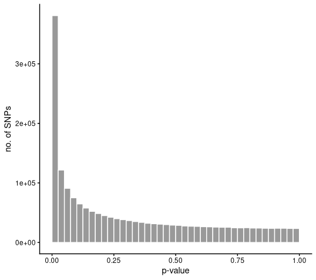
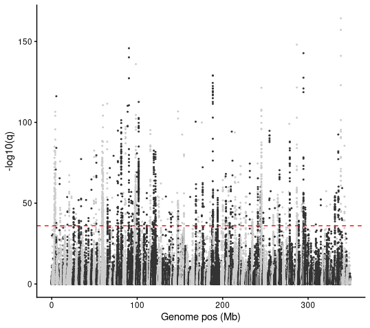

# Population Genomics Notebook

**Course:** Intro to Ecological Genomics **Name:** Ella Rewinkel

\<\div\>

# 10.13.2026 Working with Population Genomics: Class 1

**Overview**

Today, we began working with VCF (Variant Call Format) files, which have
two parts:

1.  Header: lines starting with \## that record how the file was made
    and define every field used in it

2.  Body: one line per variant

We ended with 3.5: Reading a variant record, and have not yet begun 3.6
in the tutorial for Day 1.

# 10.15.2026 Working with Population Genomics: Class 2

Today, we updated our .gitignore file to push our work from Class 1. We
looked at the NIH (Natiional Library of Medicine), and in doing so,
learned that we can find SRA Data for a species if we search for it.
This is where we got the data for our VCFs. We learned that the pathway
from last class was incorrect, so we updated it in the 10.13.2026
script.

We had to delete the new mydata files from Tuesday (which I did in the
Vacc website under Files and then Home Directory) and add the corrected
ones with this:

cp /gpfs1/cl/biol3990/PopulationGenomics/VCF/*.vcf*
/gpfs1/home/e/r/erewinke/projects/eco_genomics_2026/population_genomics/mydata

In Terminal:

nano

#!/bin/bash #SBATCH --nodes=1 #SBATCH --cpus-per-task=1 #SBATCH --mem=5G
#SBATCH --time=1:00:00 #SBATCH --output=./logs/%x.%j.out #SBATCH
--error=./logs/%x.%j.err #SBATCH --mail-type=END #SBATCH
--[mail-user=erewinke\@uvm.edu](mailto:mail-user=erewinke@uvm.edu){.email}

cd
\~/gpfs1/home/e/r/erewinke/projects/eco_genomics_2026/population_genomics/mydata

module load gcc module load vcftools

vcftools --gzvcf Lottia_gigantea_pl_flt3.renamed.vcf.gz --missing-indv
--out missing_data vcftools --gzvcf
Lottia_gigantea_pl_flt3_renamed.vcf.gz --depth --out depth_data

(now do CTRL S to submit the job and title/ID it as "vcf_stats.sh)

Just so you know (we didn't do this): squeue -u \$USER \# check your
jobs (PD = pending, R = running) scancel <jobid> \# cancel a job if you
need to

# 10.20.2026 Day 3 PopGen

## Overview

Today, we created PCA plots to differentiate populations by latitude,
and analyzed data from a previously-run ADMIXTURE. The plots are saved
in population_structure folder.

## Notes on Batch Jobs

## Extra

DATA_DIR=users/e/r/erewinke/projects/eco_genomics_2026/population_genomics/mydata
\^ this does not save in the vacc, so must put in every time

We used "module load plink" and then "module list" to get to the module
version we're using, which is plink/1.9b7.7 PLINK v1.9.0-b.7.7 64-bit
(22 Oct 2024)

Notes on Admixture: \* ADMIXTURE takes a model-based approach to
population structure. It assumes our individuals descend from K
ancestral populations, each with its own allele frequencies, and
estimates the proportion of each individual’s genome that comes from
each of them (its ancestry proportions). It uses the same model as the
program STRUCTURE but is much faster. \* We don’t know the true K, so we
run ADMIXTURE for a range of values and use cross-validation to see
which ones fit the data best.

# What I put in terminal to run the batch for today:

nano

#!/bin/bash #SBATCH --job-name=admixture #SBATCH --partition=general
#SBATCH --nodes=1 #SBATCH --cpus-per-task=8 #SBATCH --mem=16G #SBATCH
--time=24:00:00 #SBATCH --output=./logs/%x.%j.out #SBATCH
--error=./logs/%x.%j.err #SBATCH --mail-type=ALL #SBATCH
--[mail-user=erewinke\@uvm.edu](mailto:mail-user=erewinke@uvm.edu){.email}

cd
/gpfs1/home/e/r/erewinke/projects/eco_genomics_2026/population_genomics/myscripts

OUTDIR=/gpfs1/home/e/r/erewinke/projects/eco_genomics_2026/population_genomics/myresults

echo \$OUTDIR

VCF=Lottia_gigantea_pl_flt3.renamed.vcf.gz

echo \$VCF

module load plink

DATA_DIR=/gpfs1/home/e/r/erewinke/projects/eco_genomics_2026/population_genomics/myresults

VCF=\$DATA_DIR/Lottia_gigantea_pl_flt3.renamed.vcf.gz

cd \$DATA_DIR

plink --vcf \$VCF --double-id --allow-extra-chr\
--set-missing-var --indep-pairwise 50 10 0.2\
--out \$OUTDIR/Lg_LD_0.2_alldata

plink --vcf \$VCF --double-id --allow-extra-chr\
--set-missing-var --extract \$OUTDIR/Lg_LD_0.2_alldata.prune.in\
--make-bed --pca --out \$OUTDIR/Lg_LD_0.2_alldata

echo "my script is done!"

## then put "sbatch mypcajob.sh" in Terminal after exiting nano to send

\<\div\>

# 10.22.26 Genetic Diversity

**Overview** We copied pi files over and created ggplots to represent
genetic diversity.

**Notes**

- For genetic diversity, we can look:

  - within individual

  - within population

  - within species

- Metrics of genetic diversity

  - Heterozygosity

  - Private allele -\> allele richness

  - F_ST -\> fixation index (metric for looking at pop differentiation)

  - Ne -\> Genetic (pop size); Nc -\> Consensus (pop size)

  - Nucleotide diversity (depicted as pi)

  - Inbreeding coefficient -\> F_is

  - \% polymorphism

**Module Version Used**

vcftools/0.1.16

**Put in Terminal**

cd /gpfs1/cl/biol3990/PopulationGenomics

ll

cd GeneticDiversity/

ls

cp -r \*
/gpfs1/home/e/r/erewinke/projects/eco_genomics_2026/population_genomics/mydata

cd ..

cd GeneticDiversity/

module load vcftools

module list

ll

DATA_DIR=/gpfs1/home/e/r/erewinke/projects/eco_genomics_2026/population_genomics/mydata/

echo \$DATA_DIR

VCF=\$DATA_DIR/Lottia_gigantea_pl_flt3_sub0.01.vcf.gz

head sample_metadata.csv

cd
/gpfs1/home/e/r/erewinke/projects/eco_genomics_2026/population_genomics/mydata/

tail -n +2 sample_metadata.csv \| cut -d ',' -f 1,2 \| tr ',' '\\t' \>
popmap.txt

head popmap.txt

# 10.27.2026 Genetic Diversity cont'd; F_ST Genome Scans

**Overview**

Today, we generated plots to analyze genetic diversity. We also
calculated genome-wide and windowed pairwise F_ST using vcftools and
plotted an F_ST genome scan in R.

**Working Directory:**

/gpfs1/home/e/r/erewinke/projects/eco_genomics_2026/population_genomics/mydata

**Heterozygosity**

- Observed heterozygosity (HO) is the proportion of sites at which an
  individual is heterozygous.

- Expected heterozygosity (HE) is the proportion we would expect if the
  population mated at random (Hardy–Weinberg equilibrium): 2pq at each
  site, where p and q are the allele frequencies.

- The inbreeding coefficient compares the two: F = 1 − HO / HE. F = 0
  means an individual is as heterozygous as expected, F \> 0 means less
  heterozygous, and F \< 0 means more.

- Possible causes for positive F (too few heterozygotes): Inbreeding
  (mating between relatives); genotyping errors, especially at low
  coverage, where heterozygotes are miscalled as homozygotes

- Possible causes for negative F (too many heterozygotes): LESS inbred
  (mating between divergent populations); mapping errors; where reads
  from duplicated regions (paralogs) pile up on one locus and look like
  heterozygotes in everyone

**Plots**

\^ This is not saved in R.

![Scan plot for pi. Tajima's D is calculated by VCF (read in files,
windows filtered out with less than 5 SNPs, and pop data readded).
Positive selection (new beneficial allele appears and shifts
distribution/frequency over, sweeping across the population) is
signified by negative Tajima's D (there is an excess of rare alleles
sweeping through population and shifting distribution).
Negative/stabilizing selection is signified by positive Tajima's D: bell
curve gets narrower as alleles/traits are
purged.](images/clipboard-3599083371.png)

# 10.29.2026 Signatures of Selection: BayPass

**Overview**

Today, we coded in R, starting from the output of the BayPass model. We
will look at a GEA and learn how it is produced, despite not producing
it ourselves here.

**Notes**

- Bayesian statistics: give it prior information, and it builds up
  models based on the more information you give

- Advantages of BayPass

  - We can plug in covariant models (environmental, biotic, contrast
    [ex: North vs South] to look at what is potentially driving this
    selection

- XtX: looking for outliers without considering variables

- Bayes: looking for outliers but applying to variables

**Plots**

](images/clipboard-1470287533.png){width="504"}

Heatmap for the major matrix. There are potentially 3 major populations,
as shown with the red squares.

# 11.03.2026 Genes and Gene Ontology

**Overall**

Today, we coded for a GO Enrichment Test to see which candidate genes
are in the top term and which are enriched. We identified environmental
outliers, their types of change, and the most strongly associated SNPs
through SnpEFF.

**Notes**

- Gene Ontology (GO) is a shared vocabulary of terms describing gene
  functions

  - Biological Process (BP): the larger bio program a gene contributes
    to

  - Molecular Function (MF): function of gene product at molecular level

  - Cellular Component (CC): gene product location in cell

- GO Enrichment Test shows whether candidate genes (annotated with a
  particular GO term) are represented more often than expected by
  chance, given all genes we could have found

  - "Annotated" genes: genes in the universe with the GO term

  - "Significant" genes: candidate genes with the term

  - "Expected": expected number of candidates in the term by chance

- Factors that could bias a GO Enrichment test:

  - Universe

  - Gene length

  - Neighboring genes

  - Many tests

- We can check what our genes correspond to on NCBI Gene
  (<https://www.ncbi.nlm.nih.gov/gene/>) by searching for the gene ID

**Plots**

Discussion of meaning/storytelling:

Population Structure

- PCA: Do individuals cluster by site or region?

  - Region clustering (sites in the same region are clustered together)

- ADMIXTURE: How many genetic groups are there, and are individuals of
  mixed ancestry?

  - 3 groups (green, pea green, all red)

  - K=5 has too much noise & error

  - Southermost groups (2 pops for Bahia) are distinct from all 5
    admixtures. This area has up-welling and is colder than a population
    slightly more north. There may not be much dispersion due to
    geography

- Genetic diversity and signatures of selection:

  - pi and heterozygosity: Which populations are more or less diverse?

    - Pi vs latitude corrected data scatterplot: shows that as latitude
      increases, there's a linear trend with now the nucleotide
      diversity decreases

    - Northern populations are less diverse than southern populations

    - Pi along scaffold facet graph: shows diversity in each population

      - Shows that heterozygosity is a good marker for finding other
        factors to look into within specific environment that causes
        clustering of same nucleotides in specific populations (look at
        gene ontology)

  - Tajima's D: Are there regions of positive +/ balancing selection?

    - Tajima's D violin plot. Negative values indicate positive
      selection; positive values indicate balancing selection

      - Shows averages of Tajima's D for each specific population

      - No strong association, but some outliers (like in ASU site) show
        more influence of positive selection due to greater average
        shift toward negative values

        - It may be useful to create a pi along scaffold graph for
          Tajima's D to get a better idea rather than general pattern

  - F_ST: How different are the populations and which ones stand out?

    - Pairwise FST heatmap

      - FST values are extremely low when they're all compared to their
        species

      - Reddest boxes = southernmost populations, essentially equal to
        each other when compared to each other (0). When compared to
        rest of groups, there is greater variation.

      - FST = larger values is more difference; smaller values is less
        difference

    - FST_vs_Distance

  - Baypass XtX\*: Which SNPs are more differentiated than the
    populations demography alone predicts?

    - XtX uses matrix of values accounting for similarity, using as
      coefficients to scale heterozygosity so it isn't strictly a
      parewise phenomenon. Based on genetic flow between populations

    - Identified 1822 SNPs (which are significantly differentiated)

    - BayPass Omega Tree: Shows populations clustered. Looking at SNPs
      found through this, we can look at trends with environmental
      association

- Genotype x Environmental Associations:

  - Baypass Covariate Model (*BF*): Which SNPs are associated with
    latitudinal or temperature differences?

    - Baypass BF scan full: red color indicates decisiveness

    - Can see specific significant SNPs in very clear dotted lines

    - Big difference between SNPs for lat compared to surface
      temperature (more significant SNPs associated with latitude)

    - Looking at specific SNPs, top LAT and Top SST-associated SNP plots

      - Found no clear pattern for surface temp

      - Found clear association between latitude and top SNP, which is
        consistent since latitude makes a difference (sanity check to
        ensure results are correct)

      - Finding regions significant in both of the plots

- Genes of Interest:

  - Gene types (SnpEFF): Where are the outlier SNPs relative to genes,
    and what is their potential function?

    - Annocount graph: Shows total amount of SNPs for each category and
      the affect they have on the genome

    - Not many missense OR synonymous variants

      - Implies that changes made are more regulatory (functions of SNPs
        are to regulate the genes)

    - More outlier SNPs found in latitude group than surface temp (tao)
      group

  - Gene Ontology: Are the candidate genes enriched for particular
    functions?

    - Check GO website to see gene functions and see if it makes sense
      for latitude and surface temperature (apply biologically)

  # 11.17.2026 - PopGen HW #2 and Group Projects

  Today, I continued running my admixture from yesterday. To check what
  was running in terminal, I entered "squeue -u \$USER". In class, we
  worked on group projects.
